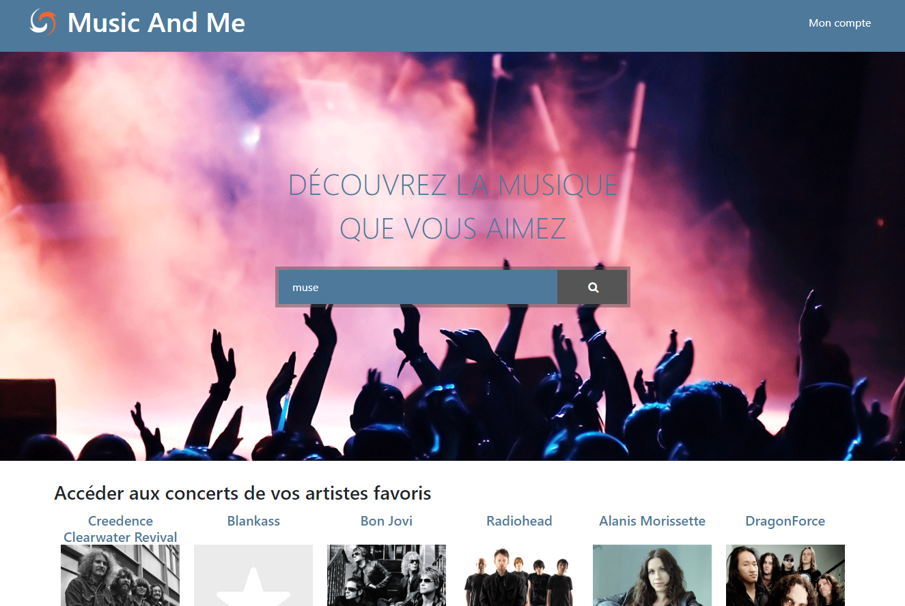
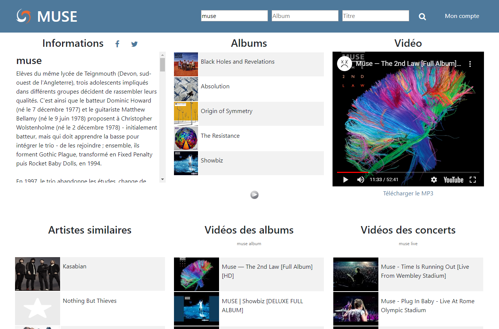
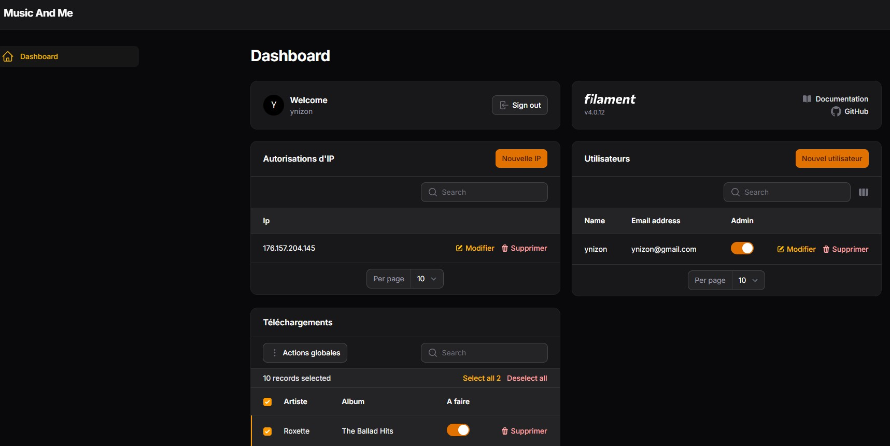

## Goal
A web interface, to discover and listen new music artists.
It's a mashup website with lastfm / youtube with Laravel / PHP 8.6.

## Screenshots
Front:


Back:


## Installation

``` 
git clone git@github.com:ynizon/music.git
cd music
cp .env.example .env (update .env with your conf)
composer install
php artisan key:generate
php artisan migrate --seed
```

## Docker

The image `ynizon/music` contains all the code: updating the site means pulling a new image.
Persistent data lives in a volume mounted on `/data` (see `docker-compose.yml`):

```
/data/.env
/data/database/database.sqlite
/data/storage/
/data/public/images/cache/
```

Missing folders and an empty database are created on startup, and migrations run automatically
(`RUN_MIGRATIONS=true`). Sitemaps are generated in `storage/app/sitemaps`
(`php artisan sitemap:generate`).

## Spotify Link (open and download)
Create your app on Spotify and set your api keys in the .env file
With this, you can :
- have links to open albums on Spotify on the front.
- If you have a <a href="https://github.com/spotDL/spotify-downloader">spotdl docker</a>, 
you can connect this app to lidarr, and automatize download from monitored artist.
If it detects new albums, you can see them in /spotdl . Check them to download.
